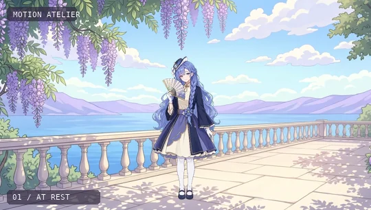

# PetDesk · Qwen 娘桌宠

**开启后，先出现的是你桌面上的 Q 版蓝发伙伴，不是工作台，也不是网页。** 她在普通应用窗口上方活动。不抢键盘焦点、不占任务栏。**角色所在的小窗始终接收鼠标和文件拖放**，包括两腿之间的空隙；小窗以外不拦点击。需要让出一块位置时可以拖开她，或在托盘暂时隐藏。

[下载本地测试版](https://github.com/TNT-THT/-second-/releases/tag/petdesk-v1.2.0) · [启动与验收清单](docs/LOCAL-TEST.md) · [动作演示与实现](docs/MOTION.md) · [形象说明](docs/ART.md)

<p align="center"></p>

**如果已开着旧版，请先从托盘退出旧进程，再把新版解压到新文件夹运行。**

## 先跑起来

- **Windows 10/11 x64**：如下载完整 `Windows-x64.zip`，整体解压，双击 `PetDesk.exe`。使用轻量 `PetDesk-1.2.0-Starter.zip` 时，整体解压后双击 `Start-Windows.cmd`；不需要 Node/Python。首次需从官方 GitHub 下载并校验固定版本的 Electron，此后离线可用。解压目录内会生成直接启动的 `PetDesk.lnk`。
- **macOS / Linux**：同一个 Starter 包提供 `Start-macOS.command` 和 `Start-Linux.sh`。支持 Intel/Apple Silicon 及 Linux x64/arm64，需满足 Electron 的系统要求。Linux 需有图形桌面、合成器、X11 或 XWayland 和 Electron 系统库；纯 Wayland 不保证允许应用自行定位窗口。若系统安全策略不允许运行未签名测试包，可使用源码方式，不必关闭安全保护。
- **管理与退出**：右键角色或系统托盘（macOS 菜单栏）图标 → 工作台 / 导入模型 / 隐藏或显示 / 退出。若托盘被系统隐藏，可以**再次启动同一程序**找回工作台。关闭工作台不会打断桌宠；要彻底结束，请选「退出 PetDesk」。

## 她可以做什么

| 操作 | 实际效果 |
| --- | --- |
| 拖动、松手 | 步行模式在半空松手会加速下落，脚碰到桌面或可站立的窗沿才屈膝回弹。关闭漫游也不会悬空。贴住侧边 / 顶部时可攀附。 |
| 在桌面与窗口上活动 | 独立透明小窗可在普通应用上方移动。Windows 还支持落在**当前前台非最大化窗口**上沿、沿窗散步、跟随移窗；支撑消失会下落。无需截图。 |
| 步行 / 飞行 | 默认左右迈步、攀边、沿顶部抓绸环换手。主动选择自由飞行后才会乘扇悬停、在屏幕内二维巡航。禁用飞行或换到不支持的模型就下降。 |
| 待机与互动 | 停下时可选扇舞、绘本、茶歇、随机或安静待机。点按、说说话、投喂、报时等各有轮换台词，离线运行。 |
| 动作手册 | 15 项表演，在当前形象上试映。可分别禁止飞行、攀爬、悬挂或可选消遣等；禁用会改变真实行为。基础下落 / 落地始终保留。 |
| 造型与大小 | 两款内置 Q 版「花庭蓝 / 藤铃紫」；模型卡、头像、桌宠与动作试映同步。首页 60%–160% 等比调节，重启保留。 |
| 导入模型 | PNG / 动态 GIF / WebP；真正渲染自包含的 GLB 2.0，优先切换模型内已有的步行、攀行、进食等命名动画，缺失时回退。模型库内可一键试用自制的动画 GLB。 |
| 拖文件给她 | **每次**弹出系统确认框，显示绝对路径和大小。只有确认并成功送入系统回收站，才算吃掉。取消或回收失败不计入进食。 |
| 桌面小工具 | 仅按你的要求打开下载文件夹、系统计算器，或告诉你本地时间。没有任意命令或任意程序启动接口。 |

**形象**：保留深蓝礼帽、侧辫、象牙白衣裙和紫藤花庭，改为适合小尺寸的矢量 Q 版。手、脚、眼睛、扇子和手中道具均能独立运动。不是 Live2D，也不需要图集解码。

GLB 支持基础材质和内嵌 PNG/JPEG 纹理，不支持外部 URI、Draco、Meshopt、KTX2、VRM 专属表情或 Cubism 文件。每模型最多 24 MiB，最多 20 个本地导入模型。



## 喂食与本地权限

1. 仅接受桌面、下载、文档目录中的单个普通文件，最多 100 MiB。扩展名：`txt md csv log pdf png jpg jpeg gif webp`。不把目录、链接（含链接父目录、硬链接）、隐藏路径、应用包或已知系统/本应用目录当食物。
2. 文件来自真实的拖放/文件选择器。主进程在确认前后分别检查路径、文件标识、大小和时间戳；确认默认选项是 **取消**。没有永久删除回退，不清空回收站。系统回收站仍受你的系统保留策略管理，重要文件请备份。
3. 导入模型是**复制**，移除模型只是移除私有副本，与喂食不同。导入的图片需通过签名与解码检查；GLB 必须内嵌资源，不加载脚本或远程贴图。
4. UI 运行在隔离、沙箱化的 Electron 渲染进程中，只加载打包静态资源。系统操作固定白名单；无键盘监听、截图、剪贴板读取、遥测、账号、后台上传、自动更新或开机自启。只有启动器首次下载运行时、或你主动点下载链接时需要联网。
5. 状态保存在 Electron 的 `userData` 目录（通常为 `%APPDATA%/PetDesk`、`~/Library/Application Support/PetDesk` 或 `~/.config/PetDesk`）；日志最多 100 条，不记投喂路径。模型副本存于本地 IndexedDB。浏览器预览有独立存储，**永远只模拟投喂**。

## 可选工作台（不是桌宠活动的边界）


工作台的庭院是调试/试装背景；「练习窗沿」是模拟平台。只有 Windows 本地版会用只读小助手查询前台窗口的可见边框（可关闭）；不读取标题或内容。macOS/Linux 在普通窗口上方活动，但不吸附其他应用的窗沿。真实桌面端使用独立、小尺寸、透明、不可聚焦的置顶窗口，只有角色和短暂的交互反馈；不会创建全屏遮罩。在 UAC 安全桌面、锁屏或独占全屏程序之上不承诺显示。

## 从源码运行

Node.js **22.12 或更新**；请检出包含本版本的分支或 Release 源码，不需要解包仓库原有的 `workspace/workspace`。

```sh
git clone --branch arena/647623e4-second https://github.com/TNT-THT/-second-.git PetDesk
cd PetDesk
npm ci
npm start                  # 构建后直接启动真实桌宠；首次下载官方 Electron
```

```sh
npm run dev                # 浏览器交互预览，无 OS 权限（不是桌面版）
npm test                   # 状态、路由/步态/缩放、GLB、投喂保护测试，使用临时文件
npm run bundle             # Windows 构建含前台窗沿助手；生成 out/PetDesk-1.2.0-Starter.zip 及 SHA-256
npm run smoke:desktop      # 已安装 Electron 且有图形桌面时，验证真实双窗口和 IPC
```

Windows 上可执行 `scripts/windows-portable.ps1` 构建自带 Electron 的完整便携 ZIP（先运行 `npm ci`）。`desktop/` 为原生窗口、托盘、确认与权限边界，`core/` 为可测试的共享逻辑，`src/` 为界面与模型渲染。旧上传归档原样保留，**新程序不会运行归档里的旧代码**。
