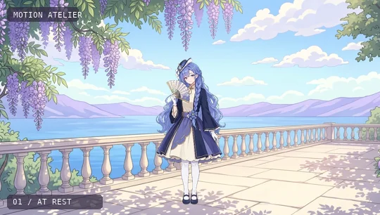

# Qwen 娘 · 动作设计手记（1.1）

**如何看**：工作台 → 实时预览右上角「动作试映」。试映只播放内置素材，不触碰文件，也不增加数值。桌面版用的是同一播放器、同一套动作。

## 人物与表演

- 保留蓝色长辫、折扇、深蓝小礼帽、象牙白立领和紫藤花庭。重新画了自然腰线、垂手到大腿上段的站姿，持扇臂能沿肩、肘、腕读出完整的弯折。修长感来自姿态，而非把整张人像纵向拉长。
- 八张独立姿势母图：正面执扇、侧身步行、面向墙壁、侧坐飞扇、提起扶帽、点心与小碟、展扇起舞、闭眼提裙。由这些姿势烘焙 **11 个动作，230 帧**。试映中的左右朝向共用同一条步态镜像，不需要用户再导入资源。
- 散步有远近两条可交叉的腿；双骨段反解膝关节，支撑期鞋底持平，抬脚期脚踝屈伸。手臂、折扇、发梢与裙摆各有控制点。攀边时两只手交替伸缩，屈膝蹬边。顶端不是把站姿倒过来：她侧坐在自己的大折扇上横渡，发束、鞋尖和扇面还有独立摆动。
- 悬停抬眼；点按闭眼提裙回礼；被提起时扶帽、晃腿，拖动速度影响摆幅；松手短暂屈膝。成功进食才捧碟咬星形饼干。自主玩耍和手动玩耍都可触发扇舞。小憩沿用闭眼姿势，另有更慢的垂首呼吸曲线。

## 实现与复现

- `art-src/qwen/`：透明母图。`scripts/art/bake-qwen.py`：离线编辑工序（Python、Pillow、NumPy、SciPy、OpenCV）。局部刚性控制点保护脸和扇骨；其间用平滑控制网格变形，图像预乘透明度后再采样。步行腿单独分层和旋转，并非整图变换。开发者从根目录运行脚本可重新生成 `public/art/motion/*.webp` 与 `core/qwen-atlas.json`；`scripts/art/make-reel.py` 可重做上方节选。**使用桌宠不需要 Python 或图像生成服务。**
- `core/motion.mjs`：桌面与预览共享边界行走状态机。先在放置的高度横向行走，抵达侧边后上下攀行，到顶切到扇上巡航；不会随机沿斜线拖着站姿横穿屏幕。实际走过的距离除以当前身高对应的步幅决定帧相位；下行反向取样，停住不空踏。贴着边缘松手可直接进入对应姿势。
- `src/QwenActor.jsx`：Canvas 2D 按帧取本地图集，延迟加载、每个窗口仅缓存最近三个图集，不需要 WebGL。大多数待机帧无需反复重画。不触发任何文件系统动作。
- 60%–160% 使用一个比例因子，原生小窗、角色和命中区同步缩放。缩放按脚底、墙面或顶部锚定；顶到屏幕限制时等比适配，不分别拉伸宽或高。
- 自带角色的精细动作不会凭空附加给外部静态图。GLB 优先按 `WalkLeft/WalkRight`、`Walk`、`Climb`、`Glide`、`Drag`、`Eat`、`Play`、`Happy`、`Sleep`、`Idle` 等名称切换已有片段，并淡入淡出；没有对应片段则回退。PNG/GIF/WebP 保留原比例和自有动画，用通用反应辅助反馈。
